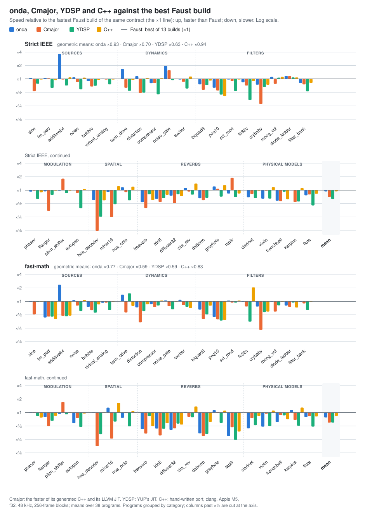

# Audio DSL bench: onda, Faust, Cmajor, YDSP

Four audio DSP languages measured on the same harness, the same programs and the same input:
[onda](https://github.com/onda-lang/onda), [Faust](https://faust.grame.fr),
[Cmajor](https://cmajor.dev) and YDSP, the JIT-compiled DSP language of the
[YUP](https://github.com/kunitoki/yup) framework (module `yup_dsp_jit`). The project started as
an onda vs Faust comparison (next section); Cmajor and YDSP are described
[below](#cmajor-and-ydsp).

<picture>
  <source media="(prefers-color-scheme: dark)" srcset="report/languages-dark.svg">
  
</picture>

## onda vs Faust

Compares the native code of onda (AOT object, strict and `--fast-math`) with Faust C++
(`-scal`/`-vec`, clang with its default contract, `-ffp-contract=off` and `-ffast-math`)
and the Faust LLVM JIT (`-scal`/`-vec`), on 18 DSP programs written equivalently in both
languages (`dsp/*.dsp` and `dsp/*.onda`), from oscillators to reverbs and three physical models
(`pm.clarinet_ui_MIDI`, `pm.violin_ui_MIDI`, `pm.frenchBell_ui`), plus 4 alternative onda writings
kept out of the means (fir32, hoa_decoder, mixer16 and frenchbell_x, next to fir32c,
hoa_decoder_x, mixer16_x and frenchbell). The faust of the certification-4 branch rejects the
violin with the current libraries (its interval analysis cannot bound the `de.fdelay4` index),
so the violin has no cert-4 columns.
One variant compiles Faust `-vec` with `-fveclib=Accelerate` (`cpp-vec-acc`). Six others come
from the faust of the `master-dev-certification-4` branch (`tools/faust-cert4`, 2.92.5):
`-lang ocpp` (`ocpp`, `ocpp-fm`), the options elected by `fcautotool` (`best-fm`, election in
`results/autotool/`, redone by `tools/autotune_all.sh`), and the same with SR fixed at 48 kHz
(`ocpp48`, `best48-fm`, plus `llvm48` for the Faust LLVM JIT). Fixed SR means the `sr48/`
copy of the libraries, where `platform.lib` says `SR = 48000.0`. Measured in November 2026 on
an Apple M5: `results/`; report: `report/audio-dsl-bench.html`.

<picture>
  <source media="(prefers-color-scheme: dark)" srcset="report/chart-dark.svg">
  
</picture>

| onda against… (geometric mean, 18 programs) | strict IEEE | fast-math |
| --- | ---: | ---: |
| Faust 2.95.1 (C++ and LLVM, every option) | ×1.18 | ×1.03 |
| best Faust, master-dev-certification-4 included | ×0.89 | ×0.77 |

Above ×1 onda is faster. Full tables and analysis: `report/audio-dsl-bench.html`.

## Cmajor and YDSP

The 18 programs are also written in Cmajor (`dsp/*.cmajor`) and YDSP (`dsp/*.ydsp`), after the
onda ports: same equations, same delay lengths, same order of operations where the language
allows (the 4 alternative onda writings have no Cmajor or YDSP version). Six engines:

| Engine | What runs |
| --- | --- |
| `cmaj-cpp`, `cmaj-cpp-fm` | the C++ class of `cmaj generate --target=cpp`, clang `-O3` (IEEE pass: `-ffp-contract=off`) or `-O3 -ffast-math` |
| `cmaj-jit`, `cmaj-jit-fm` | Cmajor's own LLVM JIT (`libCmajPerformer`), optimisation level 3, or 4 (fast maths); the sample rate is given at build time |
| `ydsp`, `ydsp-fm` | YUP's YDSP JIT (asmjit backend, host target), `fastMath` false or true (its default) |

| Against the best Faust build of the same contract (geometric mean, 18 programs) | strict IEEE | fast-math |
| --- | ---: | ---: |
| best Cmajor engine (generated C++ or JIT) | ×0.61 | ×0.53 |
| YDSP | ×0.63 | ×0.63 |
| for reference: onda | ×0.89 | ×0.77 |

Against plain Faust C++ (`-lang cpp -scal`): Cmajor ×0.91 strict, ×0.96 fast-math; YDSP ×0.93
strict, ×1.12 fast-math. Cmajor wins outright on the violin (17.5 ns against 21.4 for the best
Faust in IEEE, 10.8 against 16.3 with fast maths); its per-frame runtime and its audio copies
cost about 2 ns per sample, much more with many channels (hoa_decoder, mixer16). YDSP with
`fastMath` is the fastest of all engines on tanh_drive and beats every Faust 2.95.1 build on
freeverb (only cert-4 does better); strict, it leaves transcendentals on scalar libm (additive64,
fm_pad). Per-program tables and findings: section "Cmajor and YDSP" of the report.

Writing notes, measured while porting (they decided the form of the ports):

- Cmajor parameters are `input event` endpoints whose handlers recompute the derived
  coefficients, Cmajor's way to keep control-rate math out of the sample loop (the generated
  C++ ignores the `init` annotation of `input value` endpoints, and reads a value endpoint
  through a per-frame ramp). The state holds the defaults.
- YDSP rewards scalar state, kept in registers across the sample loop, and delay lines whose
  counter wraps at a constant (`i += 1; if (i >= 1008) { i = 0; }`), which its optimiser proves
  in range. On fdn8, a struct array of lines with a nested Hadamard loop took 44 ns/sample,
  named lines with scalar state 5.7 ns; freeverb and diffuser32 as graphs of one processor
  with a run-time `size` parameter took 14.8 and 33.9 ns, as single processors 4.4 and 19.2 ns.
- The Cmajor JIT also prefers scalars: biquad8 with its state in two `float[8]` took 19.5 ns,
  in 16 scalars 7.2 ns (the generated C++ stayed at 18 ns: its state lives in memory from one
  frame to the next). On peq10 the scalar form was slower in both languages, so it keeps arrays.

## Requirements

- A built onda: `tools/build-onda.sh` builds `../onda/target/release/onda` against MacPorts
  LLVM 21. It goes through a "shadow" prefix (`tools/make-llvm-shadow.sh`) limited to
  AArch64/ARM/X86/WebAssembly, because onda's `native/target.cpp` shim initializes every
  target of the LLVM installation (AMDGPU, etc.), which `build.rs` does not link. Otherwise:
  `ONDA=/path/to/onda ./build.sh ...`.
- `tools/faust-cert4`, the faust of the `master-dev-certification-4` branch, not versioned:
  `tools/build-faust-cert4.sh` rebuilds it from `/Users/letz/faust` (`git archive`, the
  working tree is not touched). `sr48/` (libraries with a fixed SR) is recreated by
  `tools/make-sr48.sh`, which `build.sh` calls when it is missing.
- `faust` and `/usr/local/lib/libfaustwithllvm.a` (with libz, libzstd, libxml2, libncurses
  from MacPorts in `/opt/local/lib`).
- `llvm-objcopy` from LLVM 21 (`/opt/local/libexec/llvm-21/bin`), to rename the symbols of
  the strict and fast-math onda objects, which export the same names.
- The Faust libraries of the `../faustlibraries` checkout (`FAUSTLIB` in `build.sh`;
  zita_rev depends on them).
- Cmajor 1.0.3209: `cmaj` in the `PATH` (`CMAJ=...` otherwise), the API headers in
  `/usr/local/include/cmajor` and `/usr/local/include/choc`, and
  `/usr/local/lib/libCmajPerformer.dylib`, loaded at run time by the `cmaj-jit` engines.
- A YUP checkout (`git clone https://github.com/kunitoki/yup ../yup`, or `YUP_ROOT=...`),
  CMake ≥ 3.31 and Ninja. `build.sh` builds `build/_ydsp/libydsp_engine.a` once (YUP's own
  CMake, a few minutes the first time); YUP fetches the missing upstream sources of its
  third-party modules.

## Usage

```bash
./build.sh zita_rev                  # build/zita_rev/bench
cd build/zita_rev && ./bench ../../dsp/zita_rev.dsp zita_rev 21
```

Output, one line per engine: program, engine, median ns/sample, minimum, median absolute
deviation, maximum and relative RMS difference against `cpp-scal`, finiteness, RMS of the
reference.

```bash
./run_all.sh                         # the 22 programs in two passes, ~90 min
```

`run_all.sh` regenerates `results/` and `report/audio-dsl-bench.html`. The second pass
compiles the strict C++ variants with `-ffp-contract=off` (the "IEEE" columns).
Measure on an idle machine, on AC power.

## Files

| File | Role |
| --- | --- |
| `harness.cpp` | Links the 21 engines (16 input and output channels), compares the outputs over 4 s, then times interleaved, shuffled rounds |
| `build.sh` | One program: onda objects, Faust C++ classes, Cmajor C++ classes, harness |
| `dsp/NAME.dsp`, `.onda`, `.cmajor`, `.ydsp` | The programs in the four languages |
| `tools/ext_dsp.h` | Cmajor and YDSP engines behind the Faust `dsp` interface |
| `tools/cmaj_jit.cpp`, `tools/cmaj_jit.h` | Cmajor LLVM JIT engine (C interface over the Cmajor API) |
| `tools/ydsp/` | YDSP engine: C interface over `yup_dsp_jit`, and the CMake project that builds it as a static library |
| `run_all.sh` | The 22 programs in two passes, then the report and the chart |
| `report/gen.py`, `report/template.html` | Merge the two passes (`results/results.json`) and generate the HTML report |
| `report/readme_chart.py` | Draws the README charts: `report/languages-{light,dark}.svg` (the four languages) and `report/chart-{light,dark}.svg` (onda vs Faust) |
| `tools/dumpir.cpp` | Writes the LLVM IR of a Faust LLVM factory (`writeDSPFactoryToIRFile`) |
| `tools/faust-cert4*.sh` | cert-4 faust with the faustlibraries libraries, or with `sr48/` |
| `tools/build-faust-cert4.sh`, `tools/make-sr48.sh` | Recreate the two generated, unversioned items |
| `tools/autotune_all.sh` | Elects the options of each program with `fcautotool` (~6 min) |
| `tools/ctime.cpp` | Time to create a Faust LLVM factory and an instance |

## Method notes

- onda fixes the block size (256) and the sample rate (48 kHz) at compile time;
  Faust gets `compute(256, ...)` and `init(48000)`. The Cmajor JIT gets the sample rate at
  build time too; the Cmajor C++ class (`initialise(0, 48000)`) and YDSP
  (`prepare(48000, 256)`) get it at run time.
- Cmajor exchanges audio by copies (`setInputFrames`, `advance`, `copyOutputFrames`): they are
  part of its measured time. YDSP processes the harness buffers in place.
- Faust LLVM emits every operation with fast-math flags: its columns are not IEEE.
  clang contracts into FMA by default.
- `zita_rev.onda` ports `re.zita_rev1_stereo(60, f1, f2, t60dc, t60m, 48000)` with delay
  lengths computed for 48 kHz; it is not valid at another rate.
