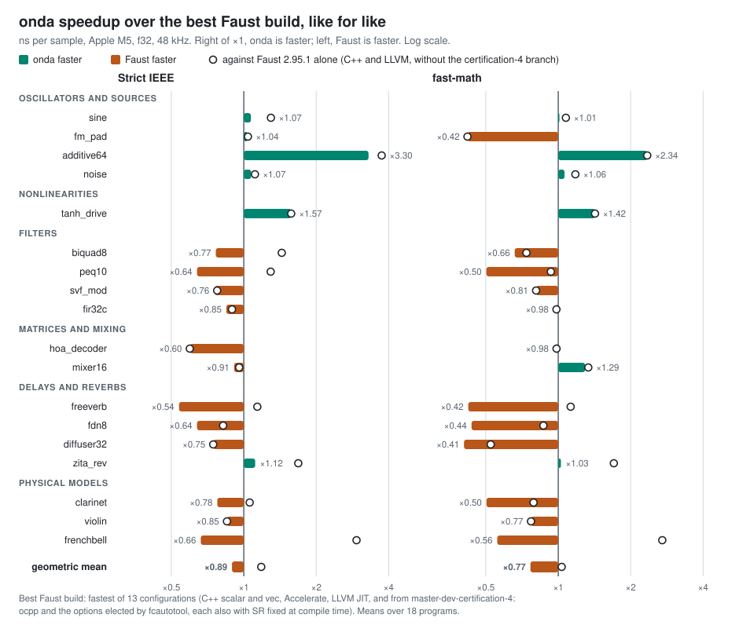

# onda vs Faust: benchmark

Compares the native code of onda (AOT object, strict and `--fast-math`) with Faust C++
(`-scal`/`-vec`, clang with its default contract, `-ffp-contract=off` and `-ffast-math`)
and the Faust LLVM JIT (`-scal`/`-vec`), on 18 DSP programs written equivalently in both
languages (`dsp/*.dsp` and `dsp/*.onda`), from oscillators to reverbs and three physical models
(`pm.clarinet_ui_MIDI`, `pm.violin_ui_MIDI`, `pm.frenchBell_ui`), plus 4 alternative onda writings
kept out of the means (fir32, hoa_decoder, mixer16 and frenchbell_x, next to fir32c,
hoa_decoder_x, mixer16_x and frenchbell). The faust of the certification-4 branch rejects the
violin with the current libraries (its interval analysis cannot bound the `de.fdelay4` index),
so the violin has no cert-4 columns.
One variant compiles Faust `-vec` with `-fveclib=Accelerate` (`cpp-vec-acc`). Six others come
from the faust of the `master-dev-certification-4` branch (`tools/faust-cert4`, 2.92.5):
`-lang ocpp` (`ocpp`, `ocpp-fm`), the options elected by `fcautotool` (`best-fm`, election in
`results/autotool/`, redone by `tools/autotune_all.sh`), and the same with SR fixed at 48 kHz
(`ocpp48`, `best48-fm`, plus `llvm48` for the Faust LLVM JIT). Fixed SR means the `sr48/`
copy of the libraries, where `platform.lib` says `SR = 48000.0`. Measured in November 2026 on
an Apple M5: `results/`; report: `report/onda-vs-faust.html`.

<picture>
  <source media="(prefers-color-scheme: dark)" srcset="report/chart-dark.svg">
  
</picture>

| onda against… (geometric mean, 18 programs) | strict IEEE | fast-math |
| --- | ---: | ---: |
| Faust 2.95.1 (C++ and LLVM, every option) | ×1.19 | ×1.06 |
| best Faust, master-dev-certification-4 included | ×0.90 | ×0.78 |

Above ×1 onda is faster. Full tables and analysis: `report/onda-vs-faust.html`.

## Requirements

- A built onda: `tools/build-onda.sh` builds `../onda/target/release/onda` against MacPorts
  LLVM 21. It goes through a "shadow" prefix (`tools/make-llvm-shadow.sh`) limited to
  AArch64/ARM/X86/WebAssembly, because onda's `native/target.cpp` shim initializes every
  target of the LLVM installation (AMDGPU, etc.), which `build.rs` does not link. Otherwise:
  `ONDA=/path/to/onda ./build.sh ...`.
- `tools/faust-cert4`, the faust of the `master-dev-certification-4` branch, not versioned:
  `tools/build-faust-cert4.sh` rebuilds it from `/Users/letz/faust` (`git archive`, the
  working tree is not touched). `sr48/` (libraries with a fixed SR) is recreated by
  `tools/make-sr48.sh`, which `build.sh` calls when it is missing.
- `faust` and `/usr/local/lib/libfaustwithllvm.a` (with libz, libzstd, libxml2, libncurses
  from MacPorts in `/opt/local/lib`).
- `llvm-objcopy` from LLVM 21 (`/opt/local/libexec/llvm-21/bin`), to rename the symbols of
  the strict and fast-math onda objects, which export the same names.
- The Faust libraries of the `../faustlibraries` checkout (`FAUSTLIB` in `build.sh`;
  zita_rev depends on them).

## Usage

```bash
./build.sh zita_rev                  # build/zita_rev/bench
cd build/zita_rev && ./bench ../../dsp/zita_rev.dsp zita_rev 21
```

Output, one line per engine: program, engine, median ns/sample, minimum, median absolute
deviation, maximum and relative RMS difference against `cpp-scal`, finiteness, RMS of the
reference.

```bash
./run_all.sh                         # the 22 programs in two passes, ~60 min
```

`run_all.sh` regenerates `results/` and `report/onda-vs-faust.html`. The second pass
compiles the strict C++ variants with `-ffp-contract=off` (the "IEEE" columns).
Measure on an idle machine, on AC power.

## Files

| File | Role |
| --- | --- |
| `harness.cpp` | Links the 15 engines (16 input and output channels), compares the outputs over 4 s, then times interleaved, shuffled rounds |
| `build.sh` | One program: onda objects, Faust C++ classes, harness |
| `run_all.sh` | The 22 programs in two passes, then the report and the chart |
| `report/gen.py`, `report/template.html` | Merge the two passes (`results/results.json`) and generate the HTML report |
| `report/readme_chart.py` | Draws `report/chart-light.svg` and `report/chart-dark.svg`, the README chart |
| `tools/dumpir.cpp` | Writes the LLVM IR of a Faust LLVM factory (`writeDSPFactoryToIRFile`) |
| `tools/faust-cert4*.sh` | cert-4 faust with the faustlibraries libraries, or with `sr48/` |
| `tools/build-faust-cert4.sh`, `tools/make-sr48.sh` | Recreate the two generated, unversioned items |
| `tools/autotune_all.sh` | Elects the options of each program with `fcautotool` (~6 min) |
| `tools/ctime.cpp` | Time to create a Faust LLVM factory and an instance |

## Method notes

- onda fixes the block size (256) and the sample rate (48 kHz) at compile time;
  Faust gets `compute(256, ...)` and `init(48000)`.
- Faust LLVM emits every operation with fast-math flags: its columns are not IEEE.
  clang contracts into FMA by default.
- `zita_rev.onda` ports `re.zita_rev1_stereo(60, f1, f2, t60dc, t60m, 48000)` with delay
  lengths computed for 48 kHz; it is not valid at another rate.
